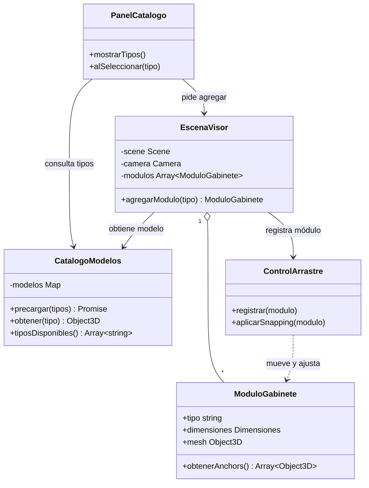
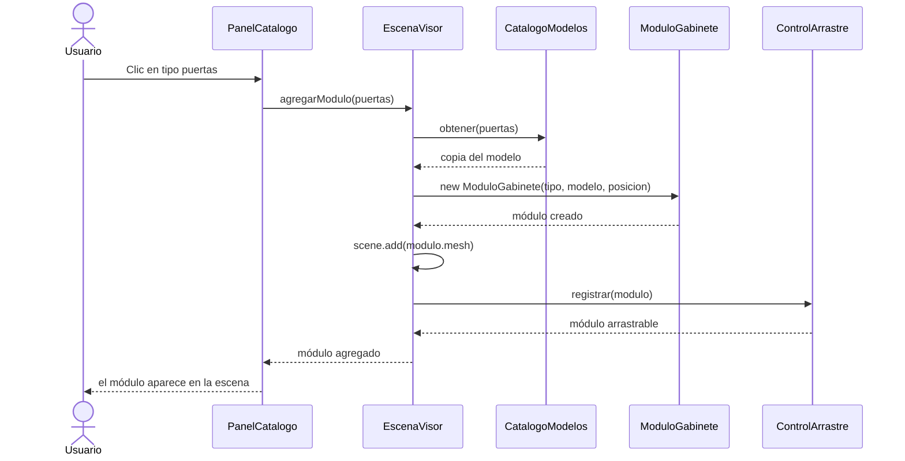

# Visualizador 3D de módulos de cocina

Aplicación web que permite visualizar módulos de cocina en 3D y combinarlos mediante snapping para planear el layout de una cocina, directamente desde el navegador y sin instalar nada.

## Problema

Planear la distribución de una cocina con módulos suele depender de planos 2D, medidas a mano o software que requiere instalación. Es difícil imaginar cómo quedan las piezas combinadas y cuánto espacio ocupan.

## Usuarios

- **Cliente final:** persona que quiere armar y ver la distribución de su cocina antes de cotizar.
- **Vendedor o dueño del negocio:** usa la herramienta para mostrar opciones y medir combinaciones con sus clientes.

## Objetivo

Entregar una versión funcional que corra con Docker, donde el usuario elija distintos tipos de módulo desde un catálogo, los acomode con snapping alineado en posición y rotación, y vea el ancho total de lo que armó.

## Alcance del mes

**Dentro del alcance:** catálogo de 3 tipos de módulo, agregar y mover módulos, snapping con rotación, medición del ancho total, ejecución con Docker.

**Fuera del alcance (por ahora):** cuentas de usuario, guardar diseños, base de datos, cotizaciones, soporte táctil para celular, publicación en WordPress.

## Tecnologías

- Three.js (renderizado 3D, GLTFLoader, DragControls, OrbitControls)
- Blender (modelado y exportación glTF 2.0)
- JavaScript, HTML5 y CSS3
- Docker

## Backlog inicial

| # | Historia de usuario | Prioridad |
|---|---|---|
| 1 | Como usuario, quiero elegir un tipo de módulo de un catálogo para agregarlo a la escena. | Alta |
| 2 | Como desarrollador, quiero ejecutar la app con un solo comando de Docker para que cualquiera la pruebe sin instalar nada. | Alta |
| 3 | Como usuario, quiero que al acercar dos módulos se alineen también en rotación para que queden bien pegados. | Alta |
| 4 | Como usuario, quiero ver el ancho total de los módulos conectados para saber si caben en mi pared. | Alta |
| 5 | Como usuario, quiero eliminar un módulo de la escena si me equivoqué. | Media |
| 6 | Como usuario, quiero rotar un módulo 90° antes de colocarlo. | Media |
| 7 | Como cliente del negocio, quiero acceder a la herramienta desde la página web del negocio. | Baja |

## Sprint 1

**Objetivo:** el usuario puede agregar distintos tipos de módulo desde un catálogo, y la aplicación se ejecuta con Docker.

**Trabajo seleccionado:** historias 1 y 2.

## Caso de uso: Agregar módulo desde el catálogo

- **Actor:** usuario.
- **Precondición:** los modelos del catálogo ya terminaron de cargarse.
- **Flujo principal:**
  1. El usuario abre la aplicación y ve el catálogo de tipos de módulo.
  2. Elige un tipo (por ejemplo, gabinete de puertas).
  3. El sistema crea una copia del modelo con su tipo y dimensiones.
  4. El sistema coloca el módulo en una posición libre del piso.
  5. El módulo queda visible y listo para arrastrarse.
- **Flujo alterno:** si los modelos siguen cargando, el sistema deshabilita el catálogo y muestra "Cargando...".
- **Postcondición:** el módulo existe en la escena y está registrado para arrastre y snapping.

## Diagrama de clases

## Diagrama de secuencia

