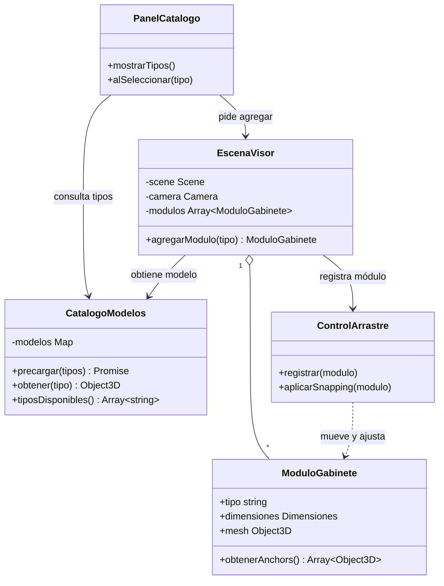
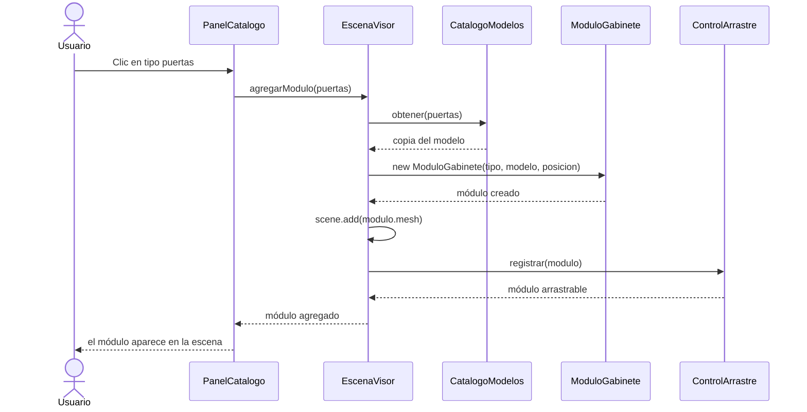

## Caso de uso: Agregar módulo desde el catálogo

- **Actor:** usuario.
- **Precondición:** los modelos del catálogo ya terminaron de cargarse.
- **Flujo principal:**
  1. El usuario abre la aplicación y ve el catálogo de tipos de módulo.
  2. Elige un tipo (por ejemplo, gabinete de puertas).
  3. El sistema crea una copia del modelo con su tipo y dimensiones.
  4. El sistema coloca el módulo en una posición libre del piso.
  5. El módulo queda visible y listo para arrastrarse.
- **Flujo alterno:** si los modelos siguen cargando, el sistema deshabilita el catálogo y muestra "Cargando...".
- **Postcondición:** el módulo existe en la escena y está registrado para arrastre y snapping.

## Diagrama de clases

## Diagrama de secuencia

